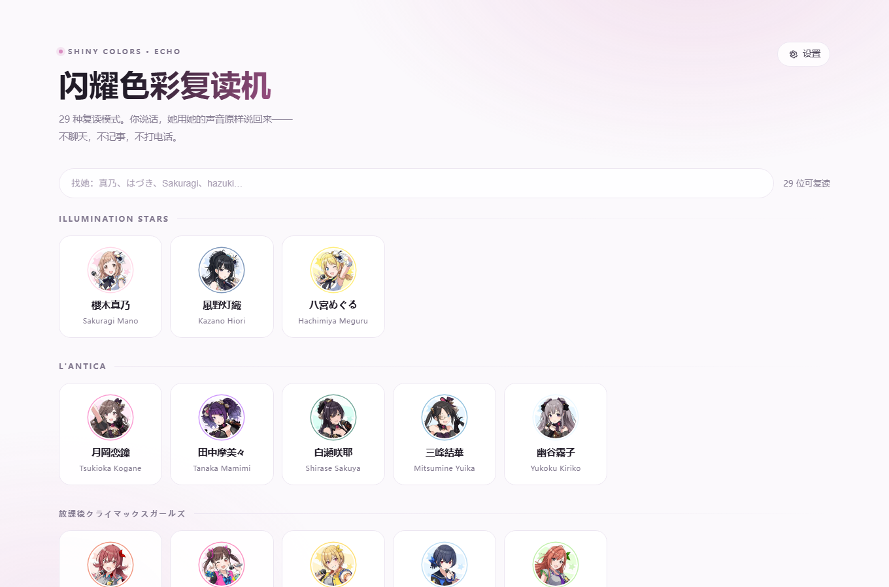
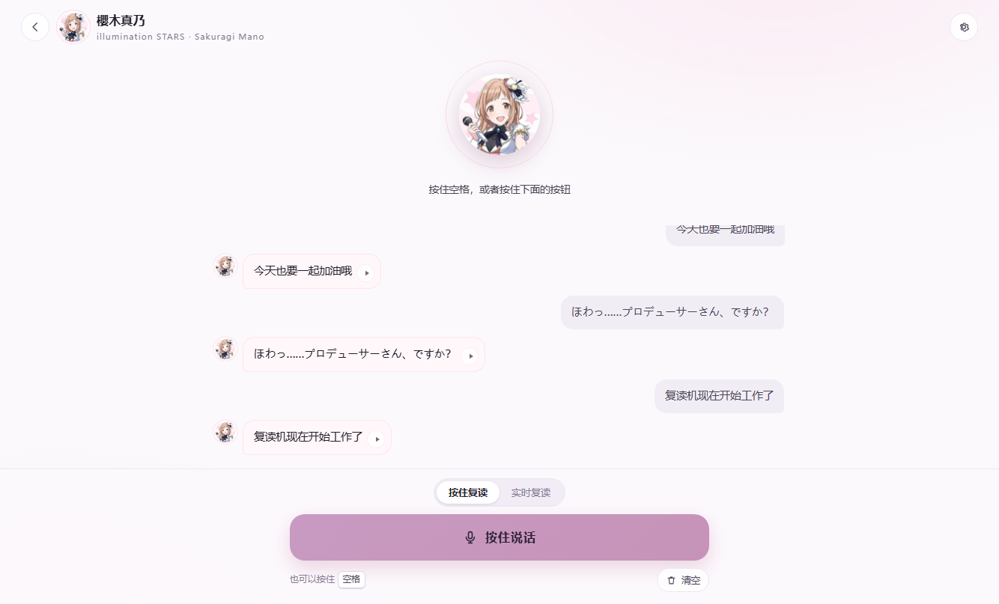

# 闪耀色彩复读机


29 种复读模式。你说话，她用她的声音原样说回来。

只有两件事：**语音合成（TTS）** 和 **实时复读**。没有对话，没有打电话，没有好感度，没有记忆，
也不存任何一条记录——关掉页面就全忘了。

改编自 [Sallyn0225/eidolon-sc](https://github.com/Sallyn0225/eidolon-sc) 的复读部分，协议同上游 AGPL-3.0-or-later。
非官方粉丝作品，与万代南梦宫及《偶像大师》系列版权方无关。

角色：illumination STARS、L'Antica、放課後クライマックスガールズ、アルストロメリア、
ストレイライト、ノクチル、シーズ、コメティック 的 28 位小偶像，加上事务员七草叶月，共 29 位，
每个人一把自己的嗓子。





---

## 跑起来

```bash
git clone git@github.com:prswanter/shinycolors-echo.git
cd shinycolors-echo
python server.py --open
```

零依赖，只用 Python 标准库（3.10+ 都行）。浏览器会打开 `http://127.0.0.1:8765`。

1. 右下角/右上角点 **设置**，填两把密钥（见下）。
2. 挑一个人 → 按住空格说话（或按住按钮）→ 松手，她就用她的声音把你刚说的话说一遍。
3. 想免按键：切到 **实时复读**，点「开始聆听」，麦克风一直开着，你说完一句停一下，她接一句。

> 麦克风只在 `127.0.0.1` 或 HTTPS 下能用，这是浏览器的规矩，不是这里的限制。

## 两把密钥

| 用途 | 服务 | 填在哪 | 备注 |
| --- | --- | --- | --- |
| 合成她的声音 | [Fish Audio](https://fish.audio) | 设置 → Fish Audio 密钥 | 默认模型 `s2.1-pro-free`，免费额度就够玩 |
| 听清你说什么 | 阿里云百炼（Qwen3-ASR） | 设置 → 阿里云百炼密钥 | 可选；不填就用浏览器自带识别 |

密钥只写进本机的 `config.json`（已加进 `.gitignore`），也可以改用环境变量
`FISH_AUDIO_API_KEY` / `DASHSCOPE_API_KEY`。

**不填百炼也能用**：把「听写方式」换成 *浏览器自带*，用 Chrome / Edge 自己的语音识别，
只需要一把 Fish Audio 密钥。它靠微软/谷歌的服务器，网络不通时会一直重试、不会自己停；
实在一直连不上，换回百炼就好。

## 两个模式

- **按住复读**：按住空格（或按钮）说话，松手 → 听成文字 → 她念同一句。松手那一刻结束录音，
  说错了也照念不误，这就是复读机。
- **实时复读**：麦克风一直开着，前端用音量做断句（说完停顿约 0.6 秒算一句），
  她一句一句跟着念。灵敏度可以在设置里调：环境吵就往左，说话小声就往右。

两种模式都只做一件事：**把你说的那句，用她的声音说回来**。

## 选设备

设置面板里可以指定 **麦克风** 和 **扬声器**，选完立即生效，记在本机，下次打开还是它。

- 下拉里第一项「系统默认」跟着系统走；往后是浏览器报给你的实际设备。
- 设备名要等浏览器给过麦克风权限才显示（Chrome 的隐私规矩）。第一次看不到名字时，
  点下拉右边的刷新按钮，允许一次麦克风，列表就会变成真名字。
- **扬声器**这项靠 `setSinkId`，Chrome / Edge 支持；Safari、Firefox 不支持，
  那一栏会变灰，声音只能走系统默认。
- **听写方式用「浏览器自带」时，麦克风选项不生效**——浏览器识别固定用系统默认麦克风。
  想指定麦克风，把听写方式换成百炼。
- 实时复读进行中换麦克风，会自动断一下再重开，不用手动停。

## 结构

```
server.py            一个文件的后端：/api/tts、/api/stt、/api/config 和静态文件
characters.json      29 位：名字、分组、印象色、Fish 音色 ID、头像
public/
  index.html         选人页 + 复读页 + 设置面板
  style.css          浅色 + 她的印象色
  app.js             录音、断句、听写、播放（没有对话逻辑）
  avatars/           29 张头像
config.example.json  密钥模板，复制成 config.json 也行
docs/                README 里那两张截图
.cache/tts/          合成过的音频（按内容缓存，同一句不再花钱），可随时删
```

## 和 [Eidolon-SC](https://github.com/Sallyn0225/eidolon-sc) 的关系

本项目的「复读」链路（`EchoComposer` + `engine.echo` + 本地 STT/TTS）取自
[Sallyn0225/eidolon-sc](https://github.com/Sallyn0225/eidolon-sc)，把那一块单独拆出来，
重写成一个只做复读的零依赖小应用。保留的只有：

- 你说一句 → 听成文字（百炼 Qwen3-ASR / 浏览器识别）
- 同一句文字 → 用这位角色的 Fish Audio 音色念出来（`characters.toml` 里的 `voice_id`）
- 气泡里留一行，标着「你说的」和「她复读的」

没有搬过来的：对话模型、通话、好感度、记忆、成就、限额、剧情库、数据库、登录。
**剧情数据、角色音色模型、立绘素材一概没有**——上游明确要求这些东西不进公开仓库
（[ADR-0003](https://github.com/Sallyn0225/eidolon-sc/blob/main/docs/adr/0003-corpus-and-voices-stay-private.md)），
这里同样没有。`characters.json` 是从上游的 `characters/characters.toml` 转出来的，
头像复制自上游仓库的 `characters/avatars/`。

## 常见问题

**没有声音？** 多半是 Fish Audio 密钥没填或余额不足，页面会用红字告诉你上游怎么回的。
点「设置 → 试听一句」最快验证。

**听不清我说什么？** 换「百炼」识别更准；或在设置里把灵敏度调高一点，靠近麦克风说。

**声音从别的设备出来了？** 设置 → 扬声器，挑你戴的那副耳机。插拔设备后面板开着会自动刷新列表；
如果选的那只被拔掉了，会自动退回系统默认并提示你。

**想要别的音色？** 改 `characters.json` 里的 `voice_id` 即可（Fish Audio 的音色要设为公开）。

## 网络与代理

后端**不看** `HTTP_PROXY` / `HTTPS_PROXY` 环境变量，只认这三样，按顺序：

1. `ECHO_PROXY`：显式指定，比如 `set ECHO_PROXY=http://127.0.0.1:7890`
2. **系统代理**：就是 Clash / v2ray 在 Windows「Internet 选项」里写的那个
3. 都没有就直连

为什么不用环境变量：有些启动器会往子进程环境里塞一个只给它自己用的隧道代理，
那个代理通常不放行 `api.fish.audio`，跟着走就会得到
`502 Tunnel connection failed`。系统代理才是你在用的那个。
（`shinycolors` 那边是 `trust_env=False` + 自己配的代理，思路一样，这里对齐了。）

常见情况：

- **Clash 开着系统代理** → 什么都不用配，直接用。
- **Clash 只开 TUN、没开系统代理** → 也不用配，直连会被 TUN 接管。
- **代理不写进系统设置** → 用 `ECHO_PROXY` 指过去。
- **想强制直连** → `set ECHO_NO_PROXY=1`（注意域名可能被污染，直连常常超时）。

报错里会写清楚这一次走的是哪条路，方便判断是代理节点的问题还是网络的问题。

**会不会偷偷录音上传？** 录音只在你按着/聆听时存在内存里，转成文字后立刻丢弃；
合成出来的音频缓存在 `.cache/tts`，其余什么都不留。

## 许可

本项目以 **[GNU AGPL-3.0-or-later](LICENSE)** 发布，与上游 Eidolon-SC 保持一致。
你修改它、再通过网络提供给别人用，就要向这些用户公开改后的源码（AGPL 第 13 条）。
版权声明、来源与素材范围写在 [`NOTICE`](NOTICE) 里。

上游同样以 AGPL-3.0-or-later 发布，所以这里必须一致，也乐意一致——
它是从人家的作品里长出来的，没有理由反过来把门关上。

**这份代码相对上游改了什么**（AGPL 第 5 条要求显著声明改动，日期为 2026-10-25）：

- 只保留复读：去掉对话模型、通话、好感度、记忆、成就、限额、剧情库、数据库、登录体系。
- 后端整段重写：FastAPI / Pipecat / Docker 换成 Python 标准库的 `server.py`（零依赖，一个文件）。
- 前端整段重写：Next.js / React 换成原生 HTML + CSS + JS，没有构建步骤。
- 数据从 TOML 转成 `characters.json`（只留 id / 名字 / 分组 / 印象色 / 音色 ID / 头像）。
- 删掉了剧情库、音色模型、立绘、背景图；Python / JS 源码是重写的，与上游逐字重合的只有
  `import`、`send_response` 这类通用语句（逐行比对过：`server.py` 246 行长行里 9 行，
  `app.js` 576 行里 22 行，全是样板代码）。

## 致谢

- **[Sallyn0225/eidolon-sc](https://github.com/Sallyn0225/eidolon-sc)** — 本项目的来源。复读这条链路、
  29 位角色的配置结构、`voice_id` 与头像都出自这里；它本身又在架构上参考了
  [LAPLACE Eidolon](https://laplace.live/eidolon)。
- **[Fish Audio](https://fish.audio)** — 语音合成。
- **[阿里云百炼](https://www.aliyun.com/product/bailian)** — Qwen3-ASR 语音识别。
- **AI 编程助手（DeepSeek）** — 本项目的大部分代码是在 AI 辅助下编写与重构的，
  所有改动均经人工审阅、实机测试后才提交。AI 生成内容不作为著作权主体，
  因此不计入 Contributors。

## 版权与免责

`public/avatars/` 的头像、角色名与所属组合，版权归 **バンダイナムコエンターテインメント /
Bandai Namco Entertainment** 与《アイドルマスター シャイニーカラーズ》各权利人所有，
这部分**不在 AGPL 的授权范围内**，随上游一并理解为非官方粉丝作品的使用，
不用于商业用途；权利人要求时会移除素材或整个仓库。

本项目是非官方粉丝作品，与万代南梦宫及《偶像大师》系列版权方无关，角色形象由原作的语音合成音色呈现。

语音合成与语音识别的账号、用量和条款，按各家服务提供方的规定，算你自己的。

